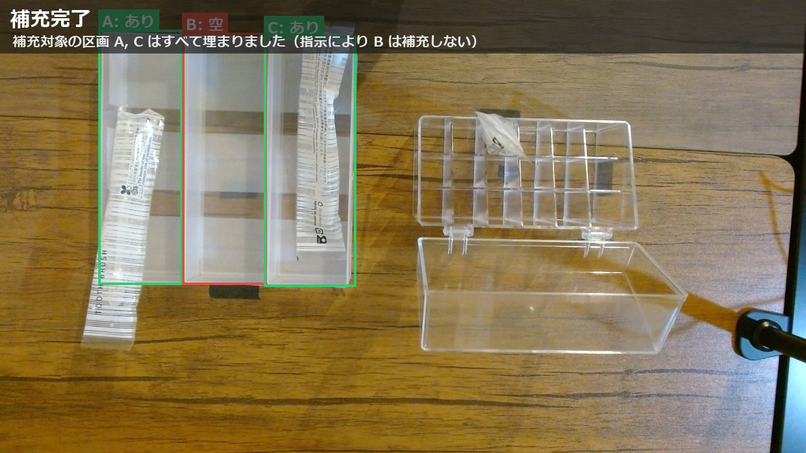
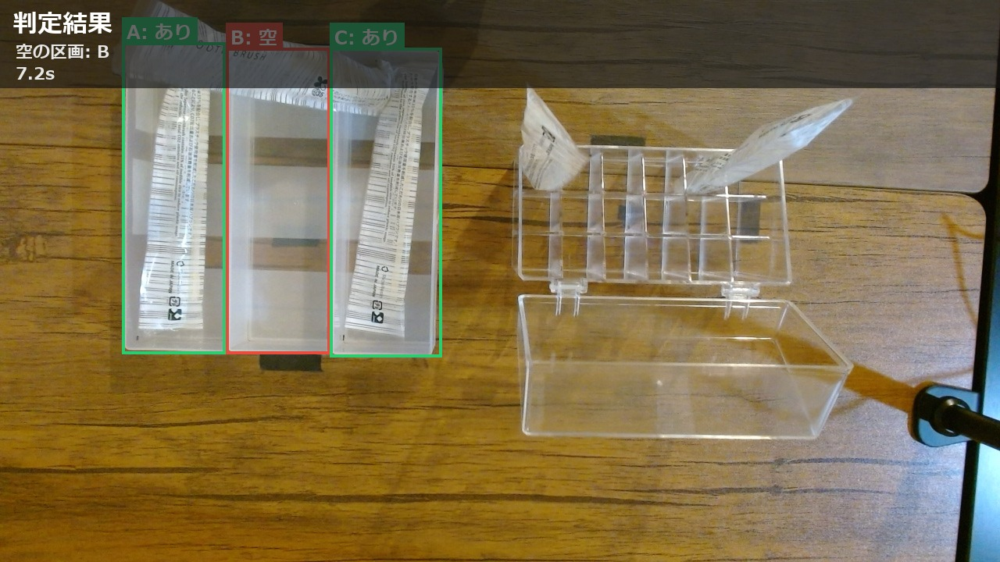

# SO-101 Amenity Refill — VLMで欠品を見つけてロボットアームが補充する

ホテル客室のアメニティトレイを真上のカメラで撮り、**空いている区画を VLM（Gemini）が判定し、LLM が補充の順番を決め、SO-101 ロボットアームが記録済みの動作を再生して歯ブラシを補充する**システムです。補充後にもう一度撮影して、補充した区画が埋まったかを確かめる閉ループになっています。

Physical AI 応用講座の最終課題として作成しました。



```
 USBカメラ（真上）                                      SO-101 フォロワー
     │ 撮影                                                  ▲
     ▼                                                       │ replay.py
 [1] 判定  VLM: 区画 A/B/C に物があるか → JSON               │ （区画ごとに記録した動作を再生）
     │                                                       │
     ▼                                                       │
 [2] 計画  LLM: 空の区画 + 作業指示 → 補充する順番 ───────────┘
     │
     ▼
 [3] 確認  再撮影 → 補充した区画に空が残っていれば再補充（最大2周）
```

## 工夫した点

- **AI の役割を分けた**：「見る」（VLM）と「決める」（LLM）を分け、どちらも JSON スキーマで出力を縛って検証する。返答が壊れていればルールで決め直す
- **動作はテレオペ記録の再生**：リーダーアームで一度やって見せた動作を区画ごとに記録して再生する。学習なしで動き、記録はそのまま LeRobot のデータセットになる
- **再生を自作した（`replay.py`）**：最初の姿勢まで 2 秒かけて移動し、終了後も姿勢を保つ。グリッパーが閉じている場面だけ記録より強く閉じる指令にして、つかんだ物が滑らないようにした
- **閉ループ**：補充後に再撮影し、入っていなければその区画だけやり直す。最後に「完了」か「未完了」かを正直に報告する
- **自然言語の指示に従う**：「AとCだけ補充して」のような指示を計画に反映し、確認でも指示で外した区画は再補充しない
- **止まらない工夫**：Gemini が混雑（503）や上限（429）を返したら別のモデルに自動で切り替える。カメラの読み込みには時間の上限を付ける

## 結果（概要）

| 項目 | 結果 |
| --- | --- |
| 判定テスト（8通りの空き方） | 8/8 正解 |
| 判定にかかった時間（本番 20 回） | 中央値 約12秒 |
| 再生の単体テスト | A 3/4、B 2/3、C 2/5（握りを強めて改善） |
| 通し実行 | 「Bだけ空」と「全部空＋指示『AとCだけ』」で、最後まで成功 |

失敗した回も、置き損ねた歯ブラシを確認撮影で見つけ、再補充したうえで「未完了」と報告した。



## 必要なもの

- SO-101（SO-ARM101）リーダー＋フォロワー（キャリブレーション済み）
- USB カメラ 1 台（真上約 50cm に固定）
- Windows 10/11、Python 3.13、LeRobot 0.6.1
- Gemini API キー（または Ollama + qwen2.5-vl などのローカル VLM）

配置は [docs/layout.png](docs/layout.png) と [docs/desk_layout.png](docs/desk_layout.png) を参照。

## セットアップ

```powershell
py -V:3.13 -m venv .venv
.\.venv\Scripts\Activate.ps1
python -m pip install "lerobot[core-scripts,feetech]==0.6.1"
python -m pip install -r requirements.txt
copy .env.example .env        # ポート・id・APIキー・カメラ番号を書く

# 実機を安定させるための LeRobot への小さな変更（いずれも --undo で元に戻せる）
python tools/patch_retry.py        # 通信に失敗したら自動でやり直す
python tools/patch_wrist_lock.py   # 手首の回転を 0°に固定（.env に LOCK_WRIST_ROLL=0 を追加）
```

`.env` は `.gitignore` に入っているので、API キーはリポジトリに含まれない。

## 使い方

```powershell
# 1. カメラ番号の確認と位置合わせ
.\scripts\01_find_cameras.ps1
python preview.py

# 2. テレオペで動作確認
.\scripts\02_teleop.ps1

# 3. 区画ごとの補充動作を記録（各3回）→ 再生テスト
.\scripts\03_record.ps1 -Slot A
.\scripts\04_replay.ps1 -Slot A -Episode 0
#    一番安定したエピソード番号と握りの強さを config.py の SLOTS に書く

# 4. AI 判定の単体テスト
python detect.py --camera

# 5. 通し実行
.\scripts\05_demo.ps1 -Mock B -DryRun                     # ロボットも API も使わない配線確認
.\scripts\05_demo.ps1                                      # 本番
.\scripts\05_demo.ps1 -Instruction "AとCだけ補充して"      # 作業指示つき
```

実行ごとに `runs/<日時>/` に撮影画像・判定 JSON・計画 JSON・ログ・注釈付き画像が残る。

## ファイル構成

| ファイル | 役割 |
| --- | --- |
| `main.py` | 通し実行（撮影 → 判定 → 計画 → 再生 → 確認） |
| `capture.py` / `preview.py` | カメラ撮影・位置合わせ |
| `detect.py` | VLM による区画の在庫判定（Gemini / Ollama / mock） |
| `plan.py` | LLM による補充手順の決定と、ルールによる代わりの決定 |
| `replay.py` | 記録した動作の再生（ゆっくり開始・握りの強化・終了後も姿勢を保つ） |
| `execute.py` | `main.py` から `replay.py` を呼び出す |
| `ai_backend.py` | Gemini / Ollama 共通の JSON 生成とモデルの自動切り替え |
| `overlay.py` | 判定結果と状態を映像に重ねて描画 |
| `config.py` / `.env.example` | ポート・カメラ・区画とデータセットの対応 |
| `prompts/` | VLM / LLM へのプロンプト |
| `scripts/` | PowerShell のスクリプト（テレオペ・記録・再生・通し実行） |
| `tools/` | 実機の調整用（LeRobot への変更、関節の角度の比較、手首の位置合わせ） |
| `docs/` | 配置図と結果の画像 |

## 参考

- [LeRobot](https://huggingface.co/docs/lerobot/il_robots)
- [SO-ARM100/101](https://github.com/TheRobotStudio/SO-ARM100)
- [Gemini API](https://ai.google.dev/gemini-api/docs/models)
